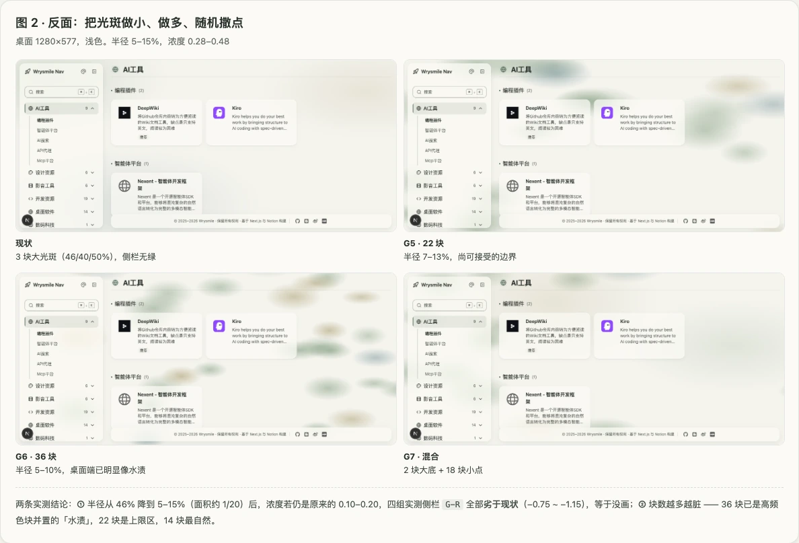
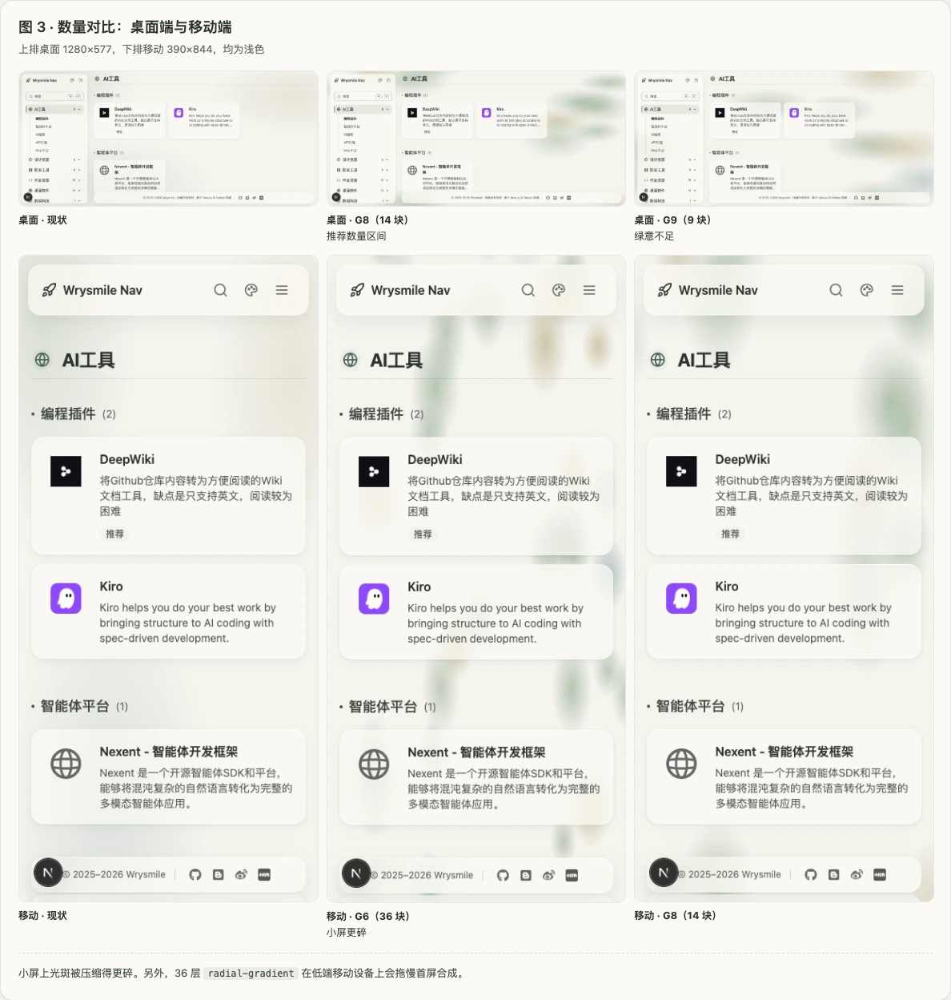
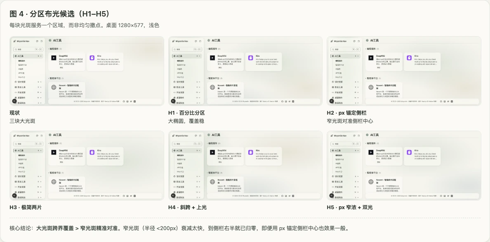
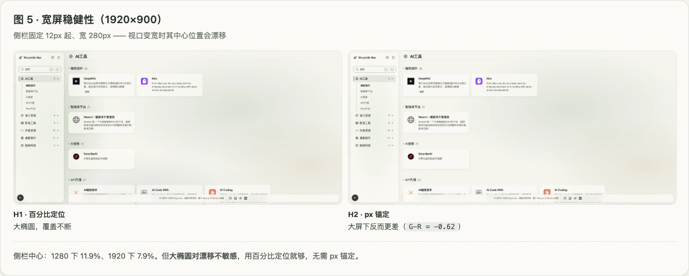
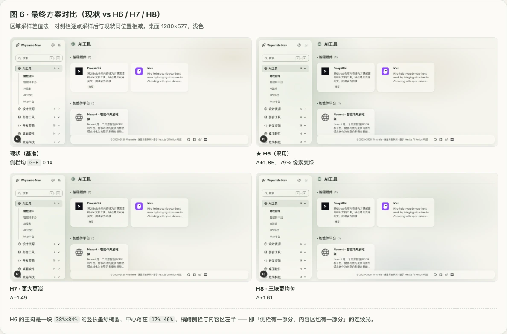
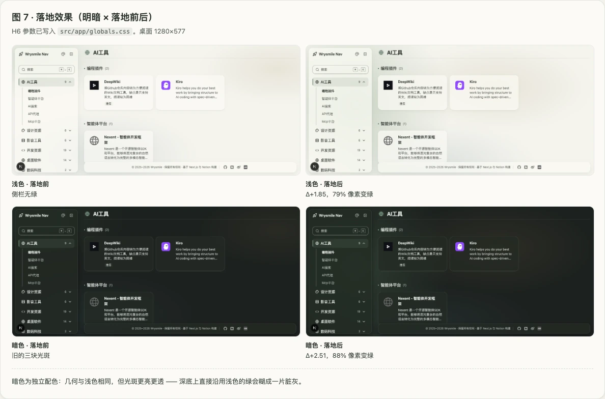

# 背景光斑布光

> **状态**：已落地 —— 参数写在 `src/app/globals.css` 的 `body` 与 `.dark body`。
> **用途**：玻璃拟态（glassmorphism）界面的背景光斑选型方法。换项目可直接取「六、复用清单」一节。
> **配套图示**：[`docs/assets/blob/`](../assets/blob/)（图 1–图 7）。

---

## 一、背景为什么要有光斑

玻璃面靠 `backdrop-filter` 模糊身后内容获得材质感。身后若只有纯色，模糊前后没有差别，玻璃读起来就是一块塑料。所以 `body` 需要铺一层有颜色起伏的背景。

本项目用三块 `radial-gradient` 承担这件事。本文件记录这些参数是怎么定下来的。

**核心结论：光斑的几何形态，比玻璃自身的不透明度重要得多。**

---

## 二、诊断：侧栏透不出背后的绿

现象：实际页面的侧栏看不见背后的绿。实测（1280×577，浅色，截图像素采样）：

| 指标 | 实际页面 | 对照 Demo |
| :--- | ---: | ---: |
| 玻璃面内 `G−R` | 0.00 | 7.80 |
| 玻璃面内亮度 | 243.8 | 221.7 |
| 玻璃面内 − 玻璃面外亮度 | **+13.0**（更白更亮） | **−9.2**（更绿更暗） |

`G−R = 0.00` 意为红、绿通道完全相等 —— **背后没有绿可透**。侧栏不是「透不出绿」，是「盖了一块白板」。

### 2.1 归因：主因是光斑，不是玻璃透明度

固定其他变量，每次只改一项，测玻璃面内 `G−R`：

| 组别 | 面内 `G−R` | 面内亮度 |
| :--- | ---: | ---: |
| 基线 | 0.00 | 243.8 |
| 只把 `--glass-bg` 0.72 → 0.50 | 0.17 | 240.3 |
| 只把光斑改成实心椭圆 | **1.50** | 240.7 |
| 两者都改 | 3.00 | 234.6 |

玻璃透明度只贡献 `0.17`，光斑形态贡献 `1.50`，相差近 9 倍。

原实现与对照 Demo 的光斑差异：

| 维度 | 原实现 | 对照 Demo |
| :--- | :--- | :--- |
| 形态 | `radial-gradient`，70% 半径处浓度即归零 | 实心椭圆 + `blur(46~60px)` |
| 浓度 | 中心 0.18，向外线性衰减 | 0.40 × 0.55 = 0.22，椭圆内基本恒定 |
| 层数 | 1 层 | 2 层（页面层 + 舞台层，叠加 ≈ 0.39） |
| 位置 | `at 8% 10%`，只盖视口左上角 | 三块分居 `top 8% / 12% / 58%` |
| 覆盖 | 只覆盖局部 | 覆盖玻璃面正后方 |

反推 Demo 侧栏正背后的背景色为 `rgb(191,208,181)`（`G−R = 17`）；实际页面同位置约为其 **1/2.4**。


---

## 三、三条实测结论

用 9 组参数在桌面 1280×577 与移动 390×844 上实测。

**1. 小面积 + 低浓度 = 等于没画。**
半径由 46% 降到 5–15%（面积约 1/20）后，浓度若仍是 0.10–0.20，测得的玻璃面内 `G−R` 全部**低于基线**（−0.75 ~ −1.15），变绿像素占比 0%。浓度补到 0.26–0.48 才可见。
感知的绿量 ≈ 面积 × 浓度 —— 面积砍了，必须用浓度补，这一步的算术躲不掉。

**2. 数量越多越脏，不是越自然。**
36 块（半径 5–10%）在桌面端已明显像水渍，这是高频色块并置的必然结果。22 块是上限区，14 块最自然。

**3. 「随机」导致覆盖不可控。**
同一采样位置上，不同随机结果的表现从「完全落空」（`G−R = −0.98`）到「明显命中」（`1.54`）大幅波动。玻璃面能否透出绿，取决于窗口尺寸与运气。





---

## 四、「随机」的正确做法

- CSS 没有可用的 `random()`（仍在草案，支持度不足）。
- 客户端 JS 生成随机坐标 → 服务端与客户端结果不一致 → **hydration mismatch**。本项目 `.agents/rules/02-编码规范.md` 中「首屏渲染必须可确定性复现」即为此设。
- 若确实需要不规则感：用**固定种子的伪随机**（如 mulberry32）生成一次，把坐标写死进 CSS。视觉不规则，每次刷新完全一致。

但实测表明，问题不在「随机」本身，而在**覆盖不受控**。因此改用下一节的分区布光。

---

## 五、分区布光（已采用）

思路：不给光斑撒随机点，而是**给每个区域分配一块光斑**。

实测 8 组，两条核心结论：

- **大光斑跨界覆盖 > 窄光斑精准对准。** 窄光斑（横向半径 < 200px）衰减太快，到玻璃面右半就已归零；即便用 px 锚定其中心，效果也一般，且大屏下更差（1920 下 `G−R = −0.62`）。
- **主斑用百分比定位即可。** 侧栏固定 `12px` 起、宽 `280px`，其中心位置随视口漂移（1280 下 11.9%、1920 下 7.9%），但大椭圆对此不敏感，无需 px 锚定。





### 5.1 浅色参数

```css
background-color: rgb(var(--background));
background-image:
  radial-gradient(38% 84% at 17% 46%, rgba(95, 130, 95, 0.28), transparent 88%),
  radial-gradient(44% 46% at 66% 32%, rgba(150, 135, 80, 0.15), transparent 78%),
  radial-gradient(46% 42% at 46% 90%, rgba(70, 110, 120, 0.13), transparent 74%);
background-attachment: fixed;
```

主斑是 `38%×84%` 的**竖长墨绿椭圆**：竖向 84% 贴合侧栏那条全高竖条；横向 38% 让它跨过侧栏、伸进内容区左半 —— 侧栏与内容区共享同一片连续的光，即「侧栏有一部分、内容区也有一部分」。

实测（差值法，基准为原三块光斑；`Δ` = 同位置绿意增量）：

| 方案 | 玻璃面均 `G−R` | 较基准 `Δ` | 变绿像素占比 |
| :--- | ---: | ---: | ---: |
| **主斑 38%×84% at 17% 46%（采用）** | 2.00 | **+1.85** | **79%** |
| 更大更淡 | — | +1.49 | — |
| 三块更均匀 | — | +1.61 | — |



### 5.2 暗色参数

几何与浅色相同，配色独立 —— 深色背景明度低，光斑需更亮更透，直接沿用浅色的绿会糊成一片脏灰。

```css
.dark body {
  background-image:
    radial-gradient(38% 84% at 17% 46%, rgba(104, 156, 112, 0.22), transparent 88%),
    radial-gradient(44% 46% at 66% 32%, rgba(150, 128, 78, 0.13), transparent 78%),
    radial-gradient(46% 42% at 46% 90%, rgba(78, 120, 132, 0.12), transparent 74%);
  background-attachment: fixed;
}
```

落地后实测：浅色 `Δ+1.85`（79% 像素变绿）、暗色 `Δ+2.51`（88%）。



---

## 六、复用清单

换项目照此走：

1. **先定玻璃面的位置与形状** —— 竖条侧栏？整宽卡片？全屏面板？光斑的尺寸与长宽比由此反推。
2. **每块光斑分配一个区域；主斑要跨过玻璃面，而不是对准它。** 这是本次最反直觉的一条：对准玻璃面的窄光斑效果最差。
3. **主斑用百分比定位 + 大尺寸**（横向半径 ≥ 38%，竖向可按需拉长至 84%），不要用 px 锚定。
4. **3 块足够**：一块主色 + 两个辅色。半径不建议低于 ~20%；若必须更小，浓度要提上去（0.26 起）。
5. **不必刻意压低玻璃底的不透明度。** 光斑形态对了，`--glass-bg` 保持 0.72 也够；调它的收益极小。
6. **暗色另配一套更亮更透的参数**，不要复用浅色的颜色值。
7. **移动端**：`background-attachment: fixed` 只在首屏绘制一次、滚动不重绘；`radial-gradient` 层数控制在 20 以内。
8. **不要用 JS 在客户端随机** —— 会触发 hydration mismatch。
9. **`prefers-reduced-motion` 下可整体关掉背景光斑**（本项目已如此）。
10. **落地后做量化验证**，方法见下一节。

---

## 七、量化方法

**指标：差值法。** 对玻璃面所在区域逐点采样，与「基准」同位置逐点相减求 `Δ`，并统计 `Δ > 0.5` 的像素占比。差值把玻璃自身底色、文字、图标的干扰全部抵消，只留下光斑的贡献。

两个**不可用**的指标：

- **单点 / 单条竖线采样**会对窄光斑得出**反向结论**：同一张图里视觉最绿的方案，采样线落在光斑衰减区外，读到的是负值。
- **玻璃面区域的平均 `G−R` 绝对值**恒在 0 附近、无法区分强弱：玻璃自身 `rgba(251,250,245,0.72)` 的 `G−R ≈ −1`，会中和掉透出的绿。

**流程**：浏览器取页面截图（分辨率取视口原生尺寸）→ 读像素逐点比较。测浅色需先设 `localStorage.setItem('theme','light')` 并重载，否则浏览器会跟随系统深色。

两个工具侧的坑（`agent-browser`）：截图输出路径**必须用绝对路径** —— 相对路径与含中文的路径都会静默失败。

---

## 附：图片清单

| 图 | 文件 | 内容 |
| :--- | :--- | :--- |
| 图 1 | [`blob-01-diagnosis.webp`](../assets/blob/blob-01-diagnosis.webp) | 诊断：玻璃面透不出背景的原因（原始 / 增强光斑对照） |
| 图 2 | [`blob-02-anti-random.webp`](../assets/blob/blob-02-anti-random.webp) | 反面：小光斑 + 随机分布（现状 / 22 块 / 36 块 / 混合） |
| 图 3 | [`blob-03-count.webp`](../assets/blob/blob-03-count.webp) | 数量对比：桌面端与移动端 |
| 图 4 | [`blob-04-zoning-candidates.webp`](../assets/blob/blob-04-zoning-candidates.webp) | 分区布光候选（H1–H5） |
| 图 5 | [`blob-05-widescreen.webp`](../assets/blob/blob-05-widescreen.webp) | 宽屏稳健性：百分比定位 vs px 锚定（1920×900） |
| 图 6 | [`blob-06-final-compare.webp`](../assets/blob/blob-06-final-compare.webp) | 最终方案对比（现状 / H6 / H7 / H8） |
| 图 7 | [`blob-07-landed.webp`](../assets/blob/blob-07-landed.webp) | 落地效果（明暗 × 落地前后） |
